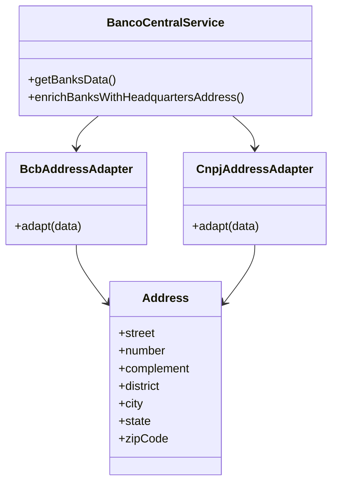

# Refatoração 1: Adapter no Serviço do Banco Central

## Problema identificado

O serviço do Banco Central conhece diretamente diferentes formatos de endereço provenientes das fontes externas utilizadas.

A função `parseAddress()` interpreta simultaneamente campos do Banco Central, como `ENDERECO`, `MUNICIPIO`, `UF` e `CEP`, e campos provenientes do serviço de CNPJ, como `logradouro`, `municipio`, `uf` e `cep`.

Isso aumenta o acoplamento do serviço aos formatos externos e dificulta alterações ou inclusão de novas fontes.

## Estrutura proposta

**Adapter - Padrão Estrutural**

O Adapter será utilizado para encapsular as particularidades de cada fonte externa e convertê-las para uma representação interna comum de endereço.

Serão criados dois adapters:

- `BcbAddressAdapter`: adapta os dados provenientes do Banco Central;
- `CnpjAddressAdapter`: adapta os dados provenientes do serviço de CNPJ.

Ambos produzirão a mesma representação interna:

```js
{
  street, number, complement, district, city, state, zipCode;
}
```

### Diagrama proposto



## Alterações realizadas

Foram criados os adapters `BcbAddressAdapter` e `CnpjAddressAdapter`.

A função `parseAddress()`, que anteriormente conhecia simultaneamente os formatos das duas fontes, foi removida.

O fluxo passou a utilizar diretamente os adapters:

- dados provenientes do Banco Central são processados pelo `BcbAddressAdapter`;
- dados provenientes do serviço de CNPJ são processados pelo `CnpjAddressAdapter`;

Com isso, o serviço principal deixou de conhecer os detalhes específicos dos campos utilizados por cada fonte externa.

## Validação

A refatoração foi validada utilizando os testes automatizados já existentes no projeto.

O conjunto específico de testes da API de bancos apresentou o seguinte resultado:

```text
Test Files  1 passed (1)
Tests       5 passed (5)
```

Também foi executada a suíte completa do projeto. Foram identificadas as mesmas três falhas já registradas na versão original:

- duas falhas em `diasuteis-v1.test.js`;
- uma falha em `isbn-v1.test.js`.

Nenhuma nova falha foi introduzida após a aplicação do Adapter.

## Benefícios obtidos

A aplicação do Adapter reduziu o acoplamento do serviço do Banco Central com os formatos das fontes externas.

As principais melhorias obtidas foram:

- separação da lógica específica de cada fonte;
- remoção da função que interpretava múltiplos formatos simultaneamente;
- representação interna única para endereços;
- maior facilidade para alterar o formato de uma fonte sem afetar o serviço principal;
- maior facilidade para adicionar novas fontes de endereço futuramente;
- melhoria na organização e manutenção do código.
