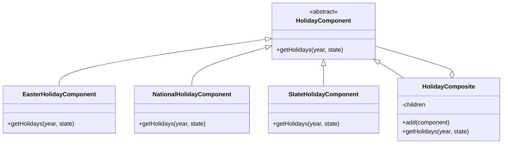

# Refatoração 2: Composite no Serviço de Feriados

## Problema identificado

O serviço de feriados concentra em `getHolidays()` o conhecimento sobre os diferentes tipos de feriados existentes no sistema.

Atualmente, o fluxo precisa executar explicitamente cada implementação:

```js
const easterHolidays = getEasterHolidays(year);
const nationalHolidays = getNationalHolidays(year);
const stateHolidays = getStateHolidays(year, state);

return sortByDate([...easterHolidays, ...nationalHolidays, ...stateHolidays]);
```

Dessa forma, o agregador conhece diretamente cada categoria de feriado. A inclusão de um novo tipo, como feriados municipais, exige modificar esse fluxo para adicionar explicitamente a nova implementação.

## Estrutura proposta

**Composite - Padrão Estrutural**

O padrão Composite será utilizado para permitir que diferentes tipos de feriados e conjuntos de feriados sejam tratados através de uma mesma abstração.

Será definida uma estrutura comum com a operação:

```js
getHolidays(year, state);
```

Os componentes individuais serão:

- `EasterHolidayComponent`: responsável pelos feriados relacionados à Páscoa;
- `NationalHolidayComponent`: responsável pelos feriados nacionais;
- `StateHolidayComponent`: responsável pelos feriados estaduais.

Também será criado:

- `HolidayComposite`: mantém uma coleção de componentes e combina os resultados retornados por eles.

Dessa forma, o serviço principal passa a solicitar os feriados ao `HolidayComposite`, sem precisar conhecer individualmente cada implementação.

## Diagrama proposto



## Funcionamento esperado

A estrutura resultante ficará conceitualmente assim:

```text
                    HolidayComposite
                    /       |       \
                   /        |        \
      EasterHoliday   NationalHoliday   StateHoliday
```

O `HolidayComposite` executará `getHolidays()` em cada componente registrado, reunirá os resultados e devolverá a coleção final de feriados.

Com isso, um novo tipo de feriado poderá ser incorporado como outro componente, reduzindo a necessidade de alterar a lógica principal de composição.

## Alterações realizadas

A lógica de composição dos feriados foi reorganizada utilizando o padrão Composite.

Foi criada a abstração `HolidayComponent`, que define a operação comum `getHolidays()`. A partir dela foram implementados os componentes:

- `EasterHolidayComponent`: responsável pelos feriados móveis relacionados à Páscoa;
- `NationalHolidayComponent`: responsável pelos feriados nacionais de data fixa;
- `StateHolidayComponent`: responsável pelos feriados estaduais;
- `HolidayComposite`: responsável por armazenar os componentes e combinar seus resultados.

O método `getHolidays()` do serviço deixou de conhecer e executar diretamente cada categoria de feriado. O fluxo passou a delegar essa responsabilidade ao `HolidayComposite`.

Os exports já existentes de `getEasterHolidays()` e `getNationalHolidays()` foram preservados por meio de funções que delegam a execução aos respectivos componentes, evitando alterações na interface existente do módulo.

## Validação

A refatoração foi validada utilizando os testes automatizados já existentes no projeto.

O conjunto específico de testes da API de feriados apresentou o seguinte resultado:

```text
Test Files  1 passed (1)
Tests       18 passed (18)
```

Também foi executada a suíte completa do projeto. Foram identificadas as mesmas três falhas já registradas na versão original:

- duas falhas em `diasuteis-v1.test.js`;
- uma falha em `isbn-v1.test.js`.

Portanto, não foram identificadas novas falhas após a aplicação do Composite.

## Benefícios obtidos

A aplicação do Composite retirou do fluxo principal a responsabilidade de conhecer e combinar diretamente cada tipo de feriado.

As principais melhorias obtidas foram:

- redução do acoplamento entre `getHolidays()` e os tipos concretos de feriado;
- separação das regras de cada categoria em componentes próprios;
- definição de uma operação comum para os diferentes componentes;
- centralização da composição dos resultados no `HolidayComposite`;
- maior facilidade para adicionar novos tipos de feriado sem alterar a lógica de agregação;
- melhoria na organização e manutenção do serviço.
