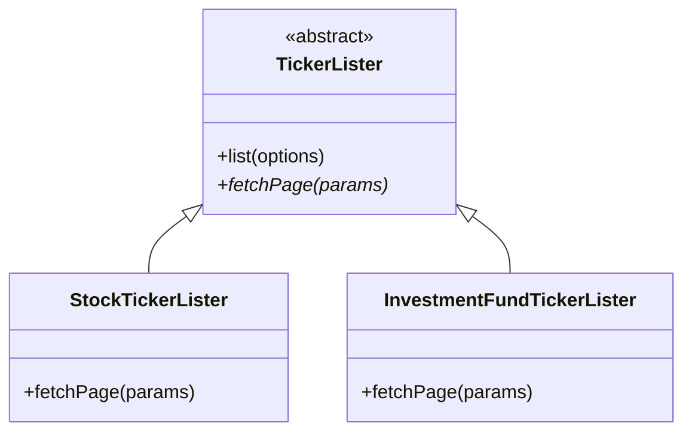

# Refatoração 4: Template Method no Serviço de Tickers

## Problema identificado

O serviço de tickers (`services/tickers/listTickers.js`) possui fluxos praticamente iguais para listar tickers de ações e de fundos de investimento, variando principalmente a função utilizada para buscar cada página.

Ambos os fluxos repetem a mesma sequência de processamento:

- busca da primeira página;
- cálculo da quantidade total de páginas;
- criação das requisições restantes;
- execução concorrente com `Promise.all`;
- agregação e consolidação dos resultados.

Essa duplicação de lógica estrutural dificulta a manutenção e o reaproveitamento do fluxo de paginação e concorrência.

## Estrutura proposta

**Template Method - Padrão Comportamental**

O padrão Template Method será utilizado para permitir reutilizar o fluxo comum de paginação e variar apenas a etapa responsável pela obtenção dos dados de cada página.

Será definida uma classe abstrata `TickerLister` com o método template `list(options)` e a operação abstrata:

```js
fetchPage(params);
```

As implementações concretas serão:

- `StockTickerLister`: implementa `fetchPage()` para consultar os tickers de ações na B3;
- `InvestmentFundTickerLister`: implementa `fetchPage()` para consultar os tickers de fundos de investimento na B3.

### Diagrama proposto



## Alterações realizadas

A lógica de paginação e consolidação dos tickers foi reorganizada utilizando o padrão Template Method.

Foi criada a classe base `TickerLister`, que define o algoritmo de paginação concorrente e agregação no método `list()`. A partir dela foram implementadas as subclasses:

- `StockTickerLister`: encapsula o schema e a requisição de ações na B3;
- `InvestmentFundTickerLister`: encapsula o schema e a requisição de fundos de investimento na B3.

O módulo `services/tickers/listTickers.js` foi refatorado para delegar a execução de `listStockTickers()` e `listInvestmentFundTickers()` às respectivas subclasses, preservando a interface pública e os schemas existentes.

## Validação

A refatoração foi validada utilizando os testes automatizados da aplicação:

```text
npm test -- tests/b3-v1.test.js

```

Também foi executada a suíte completa do projeto (`npm test`). Foram identificadas as mesmas três falhas já registradas na versão original de baseline:

- duas falhas em `diasuteis-v1.test.js`;
- uma falha em `isbn-v1.test.js`.

Portanto, não foram introduzidas novas falhas após a aplicação do Template Method.

## Benefícios obtidos

A aplicação do Template Method eliminou a duplicação do fluxo de paginação entre as consultas da B3.

As principais melhorias obtidas foram:

- centralização do algoritmo de paginação e concorrência na classe base `TickerLister`;
- isolamento das particularidades de cada tipo de ticker em subclasses específicas;
- facilidade para adicionar novos tipos de ativos com paginação semelhante sem duplicar o algoritmo de orquestração;
- melhoria na legibilidade, manutenibilidade e reutilização do código.
